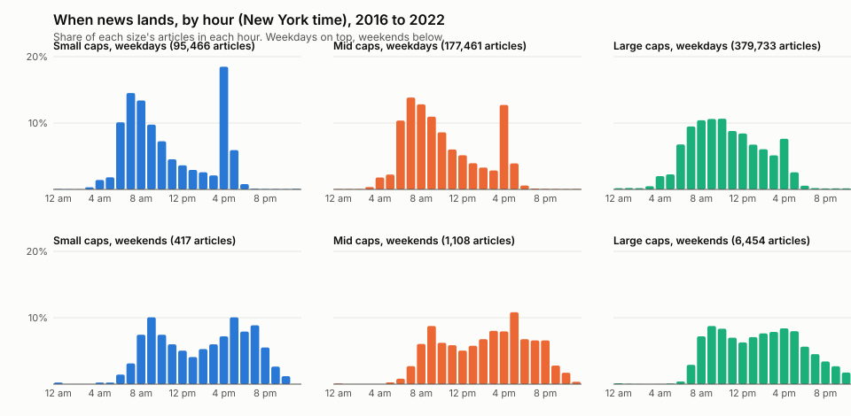
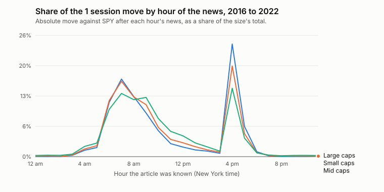
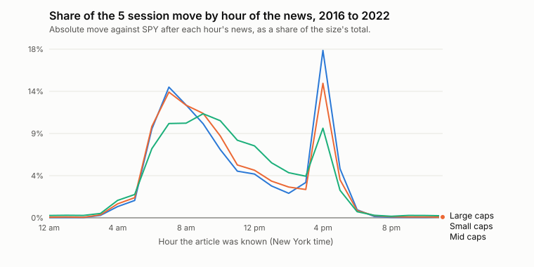
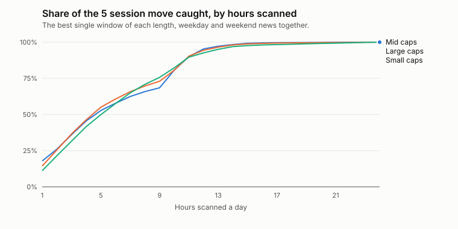

# News timing

When company news lands, and which hours' news is followed by the biggest moves. Analysis only, beside trial 11 (docs/DECISIONS.md); it changes none of trial 11's rules.

**Data:** 660,639 article and company pairs from 2016 to 2022, the training years, so the 2023 to 2026 test window stays clean; the holdout is never read. Alpaca (Benzinga) news tagging at most 3 tickers, on names in trial 9's liquid universe. Times are New York time, by when an article was known (its update time). Weekends are Saturday and Sunday; market holidays count as weekdays.

**Move:** the company's return against SPY from the last trade before the article (pre-market and after-hours included) to the close 1 and 5 sessions later, counting the article's own session as the first if it lands before 4:00 pm. A size bucket's total move is the sum of these absolute moves; each hour's share is the part that came after that hour's news. Sizes as trial 9: small under $2 billion, mid $2 to $10 billion, large above.

## When news lands

## Which hours' news moves prices

| Hour (ET) | Articles | Share of 1 session move | Share of 5 session move | Small: share of 5 session move | Mid | Large |
| --- | --- | --- | --- | --- | --- | --- |
| 12:00 am | 873 | 0.1% | 0.1% | 0.0% | 0.1% | 0.2% |
| 1:00 am | 964 | 0.2% | 0.2% | 0.0% | 0.1% | 0.3% |
| 2:00 am | 884 | 0.1% | 0.1% | 0.0% | 0.1% | 0.3% |
| 3:00 am | 2,769 | 0.4% | 0.4% | 0.3% | 0.3% | 0.5% |
| 4:00 am | 12,143 | 1.8% | 1.6% | 1.2% | 1.5% | 1.9% |
| 5:00 am | 14,324 | 2.5% | 2.2% | 1.8% | 2.2% | 2.5% |
| 6:00 am | 53,801 | 11.2% | 8.6% | 9.5% | 9.7% | 7.4% |
| 7:00 am | 74,665 | 15.3% | 12.0% | 13.9% | 13.4% | 10.1% |
| 8:00 am | 75,650 | 12.6% | 11.2% | 12.0% | 12.0% | 10.1% |
| 9:00 am | 69,755 | 11.3% | 10.9% | 10.0% | 11.1% | 11.1% |
| 10:00 am | 63,276 | 6.8% | 9.1% | 7.3% | 8.7% | 10.4% |
| 11:00 am | 48,943 | 4.1% | 6.7% | 5.0% | 5.6% | 8.3% |
| 12:00 pm | 45,042 | 3.3% | 6.1% | 4.7% | 5.1% | 7.7% |
| 1:00 pm | 35,951 | 2.3% | 4.7% | 3.4% | 3.9% | 5.9% |
| 2:00 pm | 31,878 | 1.6% | 3.8% | 2.6% | 3.3% | 4.8% |
| 3:00 pm | 27,184 | 1.0% | 3.8% | 3.8% | 3.0% | 4.4% |
| 4:00 pm | 69,848 | 18.8% | 13.0% | 17.9% | 14.4% | 9.6% |
| 5:00 pm | 23,059 | 5.0% | 3.8% | 5.2% | 4.1% | 2.9% |
| 6:00 pm | 4,388 | 0.9% | 0.7% | 0.9% | 0.8% | 0.6% |
| 7:00 pm | 1,502 | 0.3% | 0.2% | 0.2% | 0.2% | 0.3% |
| 8:00 pm | 1,037 | 0.1% | 0.1% | 0.1% | 0.1% | 0.2% |
| 9:00 pm | 987 | 0.2% | 0.2% | 0.1% | 0.1% | 0.3% |
| 10:00 pm | 828 | 0.1% | 0.2% | 0.0% | 0.1% | 0.2% |
| 11:00 pm | 888 | 0.2% | 0.1% | 0.1% | 0.1% | 0.2% |

Weekend news (Saturday and Sunday) is 0.4% of the small-cap 5 session move, 0.7% of the mid-cap 5 session move, 1.6% of the large-cap 5 session move.

## Scan windows for a live news watcher

The best single window of each length, from weekday and weekend news together (a weekend article is caught the next time the window opens):

| Catch | All sizes | Small caps | Mid caps | Large caps |
| --- | --- | --- | --- | --- |
| 50% of the move | 5 h, 6:00 am to 11:00 am | 5 h, 6:00 am to 11:00 am | 5 h, 6:00 am to 11:00 am | 6 h, 7:00 am to 1:00 pm |
| 80% of the move | 10 h, 7:00 am to 5:00 pm | 10 h, 7:00 am to 5:00 pm | 10 h, 7:00 am to 5:00 pm | 10 h, 7:00 am to 5:00 pm |
| 90% of the move | 12 h, 6:00 am to 6:00 pm | 11 h, 6:00 am to 5:00 pm | 11 h, 6:00 am to 5:00 pm | 12 h, 6:00 am to 6:00 pm |

What each extra hour of scanning adds (all sizes, best window of each length):

| Hours scanned | Window (ET) | Share caught | Added by the last hour |
| --- | --- | --- | --- |
| 1 | 4:00 pm to 5:00 pm | 13.0% | +13.0% |
| 2 | 7:00 am to 9:00 am | 23.2% | +10.2% |
| 3 | 7:00 am to 10:00 am | 34.1% | +10.9% |
| 4 | 7:00 am to 11:00 am | 43.2% | +9.1% |
| 5 | 6:00 am to 11:00 am | 51.9% | +8.6% |
| 6 | 6:00 am to 12:00 pm | 58.5% | +6.7% |
| 7 | 6:00 am to 1:00 pm | 64.7% | +6.1% |
| 8 | 6:00 am to 2:00 pm | 69.3% | +4.7% |
| 9 | 6:00 am to 3:00 pm | 73.2% | +3.8% |
| 10 | 7:00 am to 5:00 pm | 81.4% | +8.2% |
| 11 | 6:00 am to 5:00 pm | 90.0% | +8.6% |
| 12 | 6:00 am to 6:00 pm | 93.8% | +3.8% |
| 13 | 5:00 am to 6:00 pm | 96.1% | +2.2% |
| 14 | 4:00 am to 6:00 pm | 97.7% | +1.6% |
| 15 | 4:00 am to 7:00 pm | 98.4% | +0.7% |
| 16 | 3:00 am to 7:00 pm | 98.8% | +0.4% |

## Recommendation

Scan 7:00 am to 5:00 pm ET (10 hours) to catch about 80% of the 5 session move behind all sizes' news, or 6:00 am to 6:00 pm (12 hours) for 90%. For small caps alone: 7:00 am to 5:00 pm (10 hours) for 80%.

## Limits

- An article's known time can lag the event; some moves started before the article.
- The move is measured to the close, so it includes whatever else happened that day; the share by hour is a guide to where news-driven moves cluster, not a causal estimate.
- Prices are split and dividend adjusted; the last trade before an article can be up to 4 days earlier for thinly traded names.
- 2016 to 2022 only. Later years may differ.
